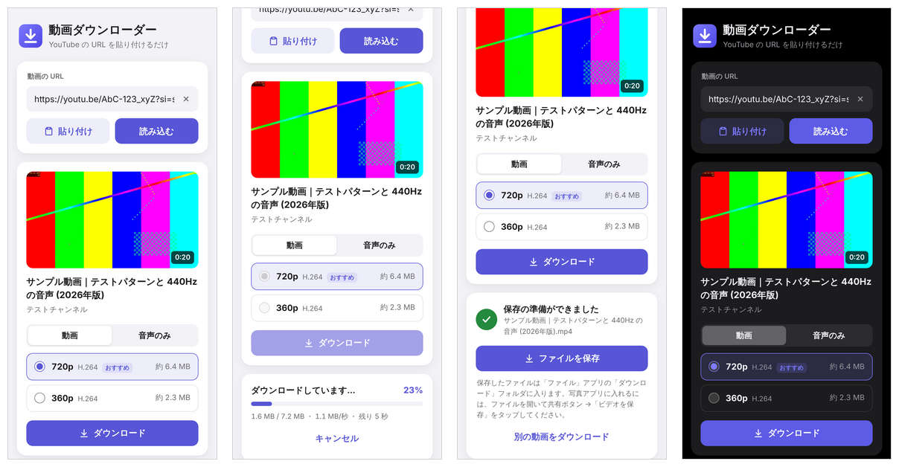

# 動画ダウンローダー（YouTube）

YouTube の動画 URL を貼り付けるだけで、動画（MP4）や音声（M4A / MP3）を保存できる Web アプリです。
iPhone の Safari で使いやすいように作っています。



## できること

- URL を貼り付けると、サムネイル・タイトル・長さと、選べる画質の一覧を表示（貼り付けるだけで自動で読み込み）
- **動画（MP4）**: 1080p / 720p / 480p … から選択。iPhone で再生しやすい H.264 + AAC を優先します
  （4K など H.264 が無い画質は VP9 / AV1 になります）
- **音声のみ**: M4A（AAC）/ MP3（192kbps）
- 進捗バー・残り時間の表示、キャンセル
- 日本語のタイトルをそのままファイル名にして保存
- スマホ向けのデザイン、ダークモード対応、ホーム画面に追加してアプリのように使える

## 必要なもの

- Python 3.10 以上
- ffmpeg は `pip install` で自動的に入ります（PC に ffmpeg が入っていればそちらを使います）

## 起動方法

### Windows（PowerShell）

```powershell
cd youtube-downloader
py -m venv .venv
.venv\Scripts\python -m pip install -r requirements.txt
.venv\Scripts\python app.py
```

### macOS / Linux

```bash
cd youtube-downloader
python3 -m venv .venv
.venv/bin/pip install -r requirements.txt
.venv/bin/python app.py
```

起動すると次のように表示されます。PC からは `http://localhost:8000` を開いてください。

```
動画ダウンローダーを起動しました
  このPCで開く : http://localhost:8000
  iPhoneで開く : http://192.168.1.23:8000  (同じWi-Fiにつないでください)
  終了するには Ctrl+C
```

## iPhone から使う

1. PC でアプリを起動し、iPhone を PC と同じ Wi-Fi につなぎます
2. iPhone の Safari で、起動時に表示された「iPhoneで開く」の URL を開きます
3. YouTube アプリの「共有」→「コピー」で URL をコピーし、入力欄に貼り付けます
4. 画質を選んで「ダウンロード」→ 準備ができたら「ファイルを保存」
5. 保存したファイルは「ファイル」アプリの「ダウンロード」フォルダに入ります。
   写真アプリに入れたいときは、ファイルを開いて共有ボタン →「ビデオを保存」をタップします

ヒント:

- Safari の共有ボタン →「ホーム画面に追加」で、アプリのように起動できます。
  ホーム画面から開いた場合は保存時にプレビューが開くので、共有ボタンから「ビデオを保存」または「"ファイル"に保存」を選んでください。
- 「貼り付け」ボタンは HTTPS か localhost で開いたときだけ表示されます。
  `http://192.168.x.x:8000` で開いた場合は、入力欄を長押しして「ペースト」してください。
- `http://<PCのIP>:8000/?url=<YouTubeのURL>` を開くと、その動画を自動で読み込みます。
  「ショートカット」アプリで共有シートからこの URL を開くショートカットを作ると、YouTube アプリから直接送れます。
- iPhone から開けないときは、PC のファイアウォールで Python の通信（プライベートネットワーク）を許可してください。
  Windows では初回起動時に許可を求めるダイアログが出ます。

## Docker で動かす

```bash
cd youtube-downloader
docker build -t video-downloader .
docker run --rm -p 8000:8000 video-downloader
```

## 設定（環境変数）

| 変数 | 既定値 | 内容 |
| --- | --- | --- |
| `PORT` | `8000` | 待ち受けるポート |
| `HOST` | `0.0.0.0` | 待ち受けるアドレス。この PC からだけ使うなら `127.0.0.1` |
| `APP_PASSWORD` | なし | 設定するとパスワード（Basic 認証）が必要になります。ユーザー名は何でも構いません。**インターネットに公開する場合は必ず設定してください** |
| `MAX_CONCURRENT_DOWNLOADS` | `2` | 同時に処理するダウンロードの数 |
| `FILE_TTL_MINUTES` | `30` | 作成したファイルをサーバーに残しておく時間（分）。過ぎると自動で削除します |
| `MAX_DURATION_MINUTES` | `0` | これより長い動画は断ります（`0` は無制限） |
| `DOWNLOAD_DIR` | OS の一時フォルダ | 作業用のフォルダ |
| `FFMPEG_PATH` | 自動で検出 | 使用する ffmpeg のパス |

例（PowerShell）: `$env:APP_PASSWORD = "好きなパスワード"; .venv\Scripts\python app.py`

## うまくいかないとき

- **「ボットと判定」「アクセスが一時的に制限」と出る**: YouTube がアクセス元を一時的にブロックしています。
  時間をおくか、別のネットワークで試してください。クラウドのサーバー（データセンターの IP）はブロックされやすいため、自宅の PC で動かすのがおすすめです。
- **急に取得できなくなった**: YouTube の仕様変更に yt-dlp が追従している可能性があります。次のコマンドで更新してください。

  ```bash
  pip install -U -r requirements.txt
  ```

- **画質が 360p しか選べない / MP3 が出てこない**: ffmpeg が使えていません。`pip install -r requirements.txt` をやり直すか、
  ffmpeg をインストールしてください（Windows: `winget install Gyan.FFmpeg`、macOS: `brew install ffmpeg`、Linux: `sudo apt install ffmpeg`）。

## 仕組み

- サーバーは Python（Flask + waitress）。YouTube からの取得には [yt-dlp](https://github.com/yt-dlp/yt-dlp) を使っています。
- YouTube の高画質の動画は映像と音声が別々に配信されているため、サーバーで両方をダウンロードし、ffmpeg で 1 つの MP4 にまとめてからブラウザに渡します。
- 作成したファイルは一定時間（既定 30 分）で自動的に削除します。

| ファイル | 内容 |
| --- | --- |
| `app.py` | Web サーバー（画面と API） |
| `downloader.py` | URL の解析、画質の一覧作成、ダウンロード処理 |
| `static/` | 画面（HTML / CSS / JavaScript）とアイコン |
| `tests/` | テスト |

API: `POST /api/info`（動画の情報）、`POST /api/jobs`（ダウンロード開始）、`GET /api/jobs/<id>`（進捗）、
`DELETE /api/jobs/<id>`（キャンセル）、`GET /api/jobs/<id>/file`（ファイルの取得）

## テスト

```bash
pip install -r requirements-dev.txt
python -m pytest
```

テストは YouTube に接続せずに動きます。

## ご利用にあたって

- 自分で投稿した動画や、権利者がダウンロードを許可している動画（クリエイティブ・コモンズなど）に限ってご利用ください。
- YouTube の利用規約では、YouTube が用意した方法以外でのダウンロードは、権利者の許可がない限り認められていません。
- 違法にアップロードされたものと知りながらダウンロードすることは、私的に使う目的であっても著作権法で禁止されています。
- このアプリを、パスワードなしでインターネットに公開しないでください。
